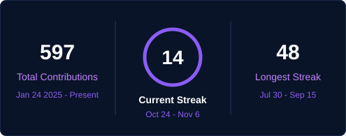

<div align="center">

```
████████╗███████╗     ██╗ █████╗ ███████╗    ███╗   ███╗
╚══██╔══╝██╔════╝     ██║██╔══██╗██╔════╝    ████╗ ████║
   ██║   █████╗       ██║███████║███████╗    ██╔████╔██║
   ██║   ██╔══╝  ██   ██║██╔══██║╚════██║    ██║╚██╔╝██║
   ██║   ███████╗╚█████╔╝██║  ██║███████║    ██║ ╚═╝ ██║
   ╚═╝   ╚══════╝ ╚════╝ ╚═╝  ╚═╝╚══════╝    ╚═╝     ╚═╝
```

<br>

<code>&gt; AI &amp; ML Student | Full-Stack Developer | Builder of AI-driven Apps</code>

<br><br>



<br>


</div>

<br>

---


- 🎓 3rd-year **B.Tech CSE (AI & ML)** student at **M S Ramaiah Institute of Technology, Bengaluru** (2024 – 2028)
- 🧠 Passionate about **Artificial Intelligence, Machine Learning, LLMs**, and building production-ready applications
- 🚀 Building **AI-driven applications** — from nutrition tracking with Gemini API to voice biometric authentication with SpeechBrain
- 🤝 Open to collaborating on interesting projects — feel free to reach out!
- 🌏 Based in **Bengaluru, Karnataka, India**
- 📫 Reach me at: [tejasmuralidhar2@gmail.com](mailto:tejasmuralidhar2@gmail.com)

<br>

---


<br>

<p align="center">
  <br>
  
  <br>
  
</p>

<p align="center">
  <br>
  
  <br>
  
  
  
  
</p>

<p align="center">
  <br>
  
  <br>
  
  
  
</p>

<p align="center">
  <br>
  
  <br>
  
  
  
</p>

<p align="center">
  <br>
  
  <br>
  
  
</p>

---


| Project | Description | Tech Stack |
|---|---|---|
| [NutriTrack AI](https://github.com/tejas-coder28/NutriTracker) | AI-powered nutrition & fitness tracker with meal-photo macro estimation | Expo, React Native, Firebase, Gemini API |
| [SOS – Emergency Alert & Live Location Tracker](https://github.com/tejas-coder28/SOS-EmergencyApp) | Real-time emergency alert system with live GPS tracking and email notifications | Node.js, Express.js, Firebase (Firestore + FCM), Nodemailer |
| [Voiceprint Identity System](https://github.com/tejas-coder28/Speech-Detection) | Voice biometric authentication using ECAPA-TDNN speaker embeddings | Python, PyTorch, SpeechBrain, Flask |
| [Bluestock Mutual Fund & Portfolio Analytics](https://github.com/tejas-coder28/Mutual-Fund-Capstone-Project) | ETL pipeline + EDA + 4-page interactive Power BI dashboard on mutual fund data | Power BI, DAX, Python |

<br>

---


<div align="center">
  
</div>

<br>

---


<div align="center">
  
</div>

<br>

---


<div align="center">
  <a href="https://www.linkedin.com/in/tejasmuralidhar" target="_blank">
    
  </a>
  <a href="mailto:tejasmuralidhar2@gmail.com">
    
  </a>
  <a href="https://github.com/tejas-coder28" target="_blank">
    
  </a>
</div>

<br>

<p align="center">
  <em>🔍 Actively seeking Software Development / AI-ML internship opportunities — let's build something impactful together!</em>
</p>
